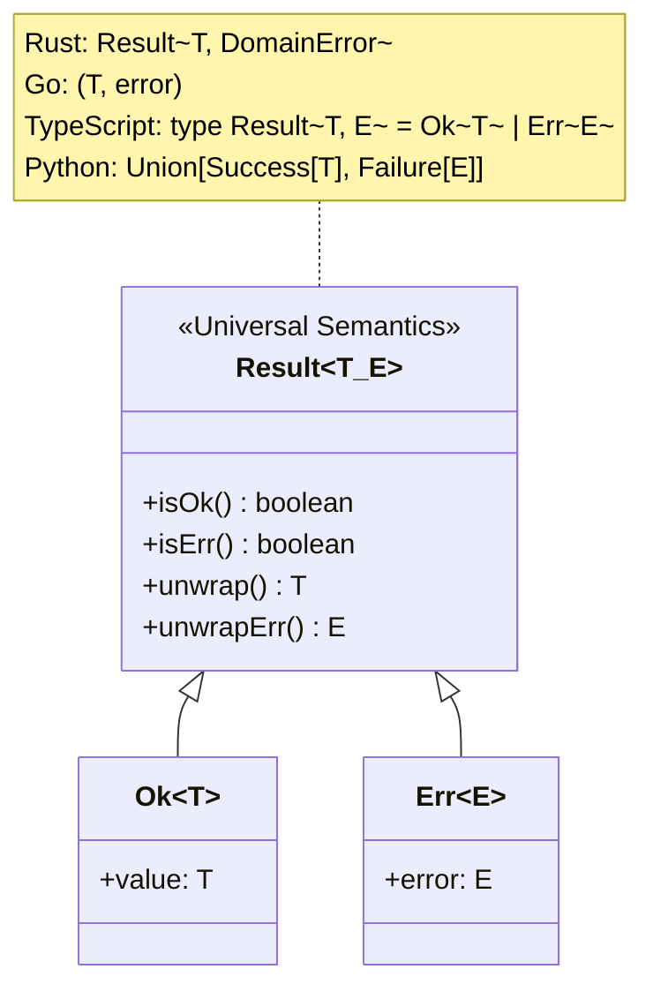

# Modern Design Patterns & Result Pattern

> **Core Mandate:** Enforce composition over inheritance, wrap third-party boundaries in project-owned adapters, and model domain errors with explicit Result types instead of untyped exceptions.

---

## 1. Structural & Creational Patterns

- **Adapter Pattern (Hexagonal Boundary)**: Wrap all external libraries, database drivers, cloud SDKs, and third-party APIs in project-owned adapter interfaces. _Rule: Only mock types you own._
- **Factory Method**: Encapsulate complex collaborator instantiation (e.g. tenant-specific payment gateways or notification dispatchers) behind factory functions.
- **Facade Pattern**: Expose a unified, simplified interface to complex underlying multi-service subsystems.
- **Decorator / Middleware**: Compose cross-cutting concerns (observability, authentication, tenant context resolution, rate limiting) via middleware pipelines.
- **Dependency Injection & Composition Hygiene**: Application factories (`createApp(deps)`) must accept an explicit composite container (`AppDependencies`). Never provide silent default fallback instances inside factories that instantiate disconnected repositories or services when partial dependencies are passed (the Split-Brain Anti-Pattern). Assemble the full dependency graph explicitly at the composition root.

---

## 2. Behavioral Patterns & Explicit Result Types

- **Strategy Pattern**: Swap algorithms or execution behavior at runtime without code changes (e.g. tenant-specific pricing algorithms, shipping calculation strategies).
- **Result / Either Pattern**: Model anticipated domain errors as explicit return values (`Result<T, E>`) rather than throwing untyped exceptions across architectural boundaries:

Domain services must return explicit Result types, compelling callers to handle failure branches deterministically.

---

## 3. Gang of Four (GoF) 23 Patterns Master Catalog

### A. Creational Patterns (5 Patterns)

1. **Factory Method**: Define an interface for creating an object, but let subclasses or factory functions decide which class to instantiate.
   - _Use Case:_ Tenant-specific payment gateway instantiation (`StripeAdapter` vs `PayPalAdapter`).
2. **Abstract Factory**: Provide an interface for creating families of related or dependent objects without specifying concrete classes.
   - _Use Case:_ Multi-cloud storage factories creating matching `FileUploader`, `FileDownloader`, and `PresignedUrlGenerator` for S3, GCS, or MinIO.
3. **Builder**: Separate the construction of a complex object from its representation, allowing the same construction process to create different representations.
   - _Use Case:_ Fluent query builders, complex report generators, or test data builders (`OrderBuilder.withItems(...).build()`).
4. **Prototype**: Specify the kinds of objects to create using a prototypical instance, creating new objects by cloning this prototype.
   - _Use Case:_ Fast cloning of default tenant configuration templates without querying storage.
5. **Singleton (DI-Scoped)**: Ensure a class has only one instance and provide a global point of access.
   - _Rule:_ Avoid global static singletons (causes test coupling). Enforce singleton lifecycle strictly through Dependency Injection (DI) containers.

### B. Structural Patterns (7 Patterns)

6. **Adapter (Mandatory)**: Convert the interface of a class into another interface clients expect.
   - _Use Case:_ Wrapping 3rd-party SDKs, storage drivers, and external network clients in application-owned interfaces. _Rule: Only mock types you own._
7. **Bridge**: Decouple an abstraction from its implementation so the two can vary independently.
   - _Use Case:_ Decoupling notification abstractions (`UrgentNotification`, `BatchNotification`) from delivery channels (`EmailChannel`, `SlackChannel`).
8. **Composite**: Compose objects into tree structures to represent part-whole hierarchies.
   - _Use Case:_ Nested RBAC permission trees or hierarchical menu navigation systems.
9. **Decorator**: Attach additional responsibilities to an object dynamically as a flexible alternative to subclassing.
   - _Use Case:_ Wrapping repository methods with distributed caching, OpenTelemetry tracing, or metrics logging.
10. **Facade**: Provide a unified, high-level interface to a complex set of interfaces in a subsystem.
    - _Use Case:_ Checkout facade orchestrating inventory verification, payment processing, invoice generation, and email notification.
11. **Flyweight**: Use sharing to support large numbers of fine-grained objects efficiently.
    - _Use Case:_ In-memory sharing of immutable tenant metadata and shared system role permission definitions.
12. **Proxy**: Provide a surrogate or placeholder for another object to control access to it.
    - _Use Case:_ Lazy-loading database relations, virtual proxies for large assets, or tenant-scoped connection proxies.

### C. Behavioral Patterns (11 Patterns)

13. **Chain of Responsibility**: Pass requests along a chain of handlers until a handler processes it or the chain ends.
    - _Use Case:_ Inbound gateway middleware pipelines (Authentication ➔ TenantResolution ➔ RateLimiting ➔ Controller).
14. **Command**: Encapsulate a request as an object, thereby letting you parameterize clients with different requests, queue or log requests, and support undo.
    - _Use Case:_ Asynchronous job queues, transactional audit commands, CQRS command handlers.
15. **Interpreter**: Given a language, define a representation for its grammar along with an interpreter that uses the representation to interpret sentences.
    - _Use Case:_ Custom search filter parsers (`status:active AND tier:pro`) or rule engine expression evaluation.
16. **Iterator**: Provide a way to access the elements of an aggregate object sequentially without exposing its underlying representation.
    - _Use Case:_ Async iterators streaming large database cursor result sets or reading multi-part upload chunks.
17. **Mediator**: Define an object that encapsulates how a set of objects interact, preventing direct coupling between them.
    - _Use Case:_ In-memory event dispatcher mediating communication between decoupled domain services.
18. **Memento**: Without violating encapsulation, capture and externalize an object's internal state so the object can be restored to this state later.
    - _Use Case:_ Audit trail snapshots recording `before` and `after` states for rollback capabilities.
19. **Observer**: Define a one-to-many dependency between objects so that when one object changes state, all its dependents are notified automatically.
    - _Use Case:_ Domain Event buses (`UserRegisteredEvent`, `PaymentFailedEvent`) invoking multiple listeners.
20. **State**: Allow an object to alter its behavior when its internal state changes, appearing as if it changed its class.
    - _Use Case:_ Subscription lifecycles (`TrialState` ➔ `ActiveState` ➔ `PastDueState` ➔ `CanceledState`) where allowed actions change dynamically.
21. **Strategy**: Define a family of algorithms, encapsulate each one, and make them interchangeable at runtime.
    - _Use Case:_ Dynamic fee calculation, tenant-specific password complexity policies, or feature flag evaluation providers.
22. **Template Method**: Define the skeleton of an algorithm in an operation, deferring some steps to subclasses.
    - _Use Case:_ Base ETL or data import pipelines with fixed steps (Extract ➔ Validate ➔ Transform ➔ Persist) where subclasses define validation.
23. **Visitor**: Represent an operation to be performed on the elements of an object structure, defining a new operation without changing the classes of the elements.
    - _Use Case:_ Document export engines traversing an AST of content blocks to generate HTML, Markdown, or PDF.
